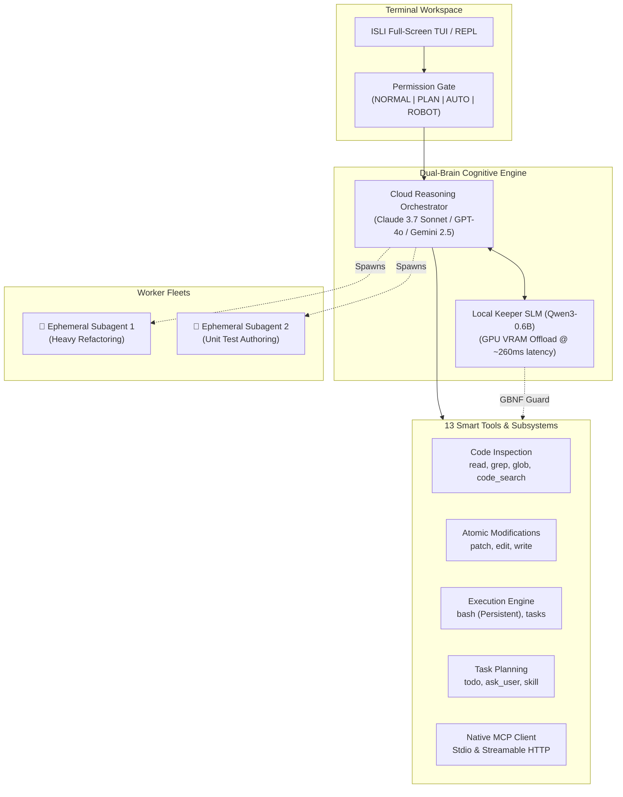

<div align="center">

# ⚡ ISLI Coder (`isli`)

### *Next-Generation Autonomous AI Coding Assistant with Dual-Brain Architecture*

[](CHANGELOG.md)
[](https://www.python.org/)
[](#testing--quality-gates)
[](#embedded-local-keeper-slm)
[](LICENSE)

<br/>

**ISLI** is a high-performance terminal AI coding assistant engineered for professional software development. By coupling an **orchestrating Cloud Reasoning Brain** with a **custom fine-tuned Local Keeper SLM** operating in GPU VRAM, ISLI cuts cloud token spend by **50% to 70%** while providing lossless code inspection, autonomous subagent fleets, and multi-tier loop reliability.

[Quick Start](#-quick-start) • [Architecture](#-architecture) • [Features](#-key-features) • [Slash Commands](#-slash-commands) • [Configuration](#-configuration) • [Changelog](CHANGELOG.md)

</div>

---

## 📸 Terminal Interface

```text
┌──────────────────────────────────────────────────────────────────────────────────────────────────────────────┐
│ [my-app] │ [normal] │ claude-3.7-sonnet │ Ctx: [====------] 38% │ [Tasks: 2/3] │ Tokens: 14.2k (🤖3.1k) │ $0.03 │
├──────────────────────────────────────────────────────────────────────────────────────────────────────────────┤
│ ┌─ ● You ──────────────────────────────────────────────────────────────────────────────────────────────────┐ │
│ │ /plan Build resilient rate limiter middleware with unit tests and Redis mock                             │ │
│ └──────────────────────────────────────────────────────────────────────────────────────────────────────────┘ │
│ ┌─ ● ISLI (claude-3.7-sonnet) ─────────────────────────────────────────────────────────────────────────────┐ │
│ │ Switched to PLAN mode (read-only). Exploring workspace and scaffolding implementation steps.             │ │
│ └──────────────────────────────────────────────────────────────────────────────────────────────────────────┘ │
│   ┌─ ⚙ todo (action='set', tasks=[...])                                                                     │ │
│   └─ ✓ Plan set (0/3 completed) -> synced to .isli/PLAN.md                                                  │ │
│   ┌─ ⚙ subagent (prompt='Implement TokenBucket in src/limiter.ts', run_in_background=True)                 │ │
│   └─ ✓ Spawned background subagent worker [sub_1]                                                           │ │
│   ┌─ ⚙ tasks (action='output', task_id='sub_1', wait_seconds=5)                                             │ │
│   └─ ✓ [sub_1 completed]: Wrote src/limiter.ts (48 lines) and verified syntax cleanly                       │ │
│ ┌─ ● ISLI (claude-3.7-sonnet) ─────────────────────────────────────────────────────────────────────────────┐ │
│ │ Implementation plan prepared and verified. Run /execute to approve and begin task execution.             │ │
│ └──────────────────────────────────────────────────────────────────────────────────────────────────────────┘ │
└──────────────────────────────────────────────────────────────────────────────────────────────────────────────┘
❯ /execute --auto_
  [↑/↓: History] [Shift+Tab: Cycle Mode] [Ctrl+J: Multi-line] [Ctrl+X M: Menu] [Esc: Interrupt]
```

---

## ⚡ Quick Start

### 1. Installation

Install globally in isolated or editable mode using [`uv`](https://github.com/astral-sh/uv) (recommended):

```bash
# Recommended: Isolated editable tool installation
uv tool install --editable .

# Or via standard pip with local Keeper SLM support:
pip install -e ".[keeper]"

# Or with CUDA 12 hardware acceleration for NVIDIA GPUs:
pip install -e ".[keeper-cuda]"
```

### 2. Configure Your Cloud Model API Key

Set the environment variable for your preferred provider:

```bash
# Anthropic Claude (Default: Claude 3.7 Sonnet)
export ANTHROPIC_API_KEY="sk-ant-..."

# Or OpenRouter (Supports 200+ frontier models)
export OPENROUTER_API_KEY="sk-or-..."

# Or OpenAI
export OPENAI_API_KEY="sk-..."
```

### 3. Launch ISLI

```bash
# Launch full-screen interactive TUI
isli

# One-shot command execution
isli "Diagnose and fix failing Jest tests in auth.test.ts"

# Launch directly into Plan Mode
isli --mode plan "Refactor database connection pool"
```

---

## 🧠 Architecture

ISLI utilizes a **Dual-Brain Architecture** to maximize reasoning depth while eliminating context bloat and token waste:



### Why Dual-Brain?
- **Cloud LLM (Orchestrator)**: Focuses exclusively on high-level system architecture, problem decomposition, code authoring, and strategic decision-making.
- **Embedded Local Keeper SLM (`qwen3-0.6b-isli`)**: An ultra-fast, local 600M parameter model fine-tuned across 340+ distillation pairs running in **GPU VRAM** via `llama-cpp-python`. It handles pre-flight shell log compression (compressing 900+ token logs by 85%), semantic search re-ranking, single-token safety classification, and code syntax validation in **~260ms**.

---

## 🚀 Key Features

### 1. Interactive Plan Mode (`/plan` & `/execute`)
- **Read-Only Exploration**: Switch to `PLAN` mode at any time with `/plan [goal]`. State-changing tools (`write`, `edit`, `patch`, modifying bash) are blocked, while read tools and read-only git operations (`status`, `diff`, `log`, `branch`) remain active.
- **Real-Time Plan Mirroring**: Task changes in `todo` automatically mirror to `.isli/PLAN.md`.
- **Seamless Approval**: Run `/execute` (or `/execute --auto`) to approve the active plan, switch modes, and immediately start execution.

### 2. Multi-File Unified Diff Patching (`patch`)
- **Atomic Multi-File Commits**: Multi-hunk unified diff engine supporting standard diff headers (`--- a/path` and `+++ b/path`), file creation, and file deletion.
- **Pre-Commit AST Syntax Validation**: Validates syntax across all affected files in memory before writing to disk; rolls back with zero disk changes if any hunk fails.
- **Lenient Tolerances**: Tolerates line-offset drift (±5 lines) and trailing whitespace normalization.

### 3. Claude Code-Style Asynchronous Subagents
- **Ephemeral Workers**: Delegate heavy refactoring, multi-file code authoring, or test suites to isolated cloud subagents via `subagent(prompt=..., run_in_background=True)`.
- **Zero Disk Debris**: Runs in pure in-memory sessions and reports concise completion receipts directly back to the orchestrator.
- **Unified Background Tracking**: Track subagents (`sub_N`) and long-running dev servers (`bg_N`) using the unified `tasks` tool (`tasks action='output' task_id='sub_1' wait_seconds=5`).

### 4. Self-Evolving Skills & Custom Tools
- **Markdown Playbooks**: Save reusable workflows and operational knowledge in `SKILL.md` files loaded on demand with `skill(load)`.
- **Declarative Custom Tools**: Turn scripts (Python, Bash) into custom agent tools (`tool.toml`) auto-registered as `custom__<name>` tools.
- **Two-Tier Storage & Trust**: Stores global skills in `~/.isli/skills/` and project-local workflows in `.isli/skills/`. Changes invalidate SHA-256 trust pinning to prevent unauthorized script execution.

### 5. Loop Reliability & Session Health
- **Stuck & Thrashing Detection**: Detects exact call repetition, cyclic ping-pong oscillation (`A → B → A → B`), zero-progress churn, and error fatigue.
- **3-Tier Recovery System**: Progresses from contextual guidance hints (Tier 1) to mandatory pivot directives (Tier 2), escalating to human clarification via `ask_user` (Tier 3).
- **Partial-Batch Truncation Resilience**: If an agent call hits the output token ceiling (`max_tokens`), valid tool calls executed earlier in the batch are saved to disk, preventing destructive retry loops.
- **Amnesia-Free Compaction**: Permanent root user goal embedding (`Root Goal: ...`) and bulky historical write observation compaction prevent loss of task context over long sessions.

### 6. Persistent Shell & Terminal Hardening
- **Zero-Deadlock Shell**: Automatically configures non-interactive pager settings (`PAGER=cat`, `GIT_PAGER=cat`, `TERM=dumb`) and stdin redirection to eliminate terminal hanging.
- **Piped Error Context**: Detects build and compiler error frames even when commands are piped through `tail` or `head`.

---

## 🛠️ Built-in Tool Matrix

| Tool | Permission Default | Description |
|---|---|---|
| `read` | **Always Allowed** | Line-numbered file reading with structural outlines and image introspection (PNG, JPEG, GIF, BMP, WEBP). |
| `patch` | Needs Approval | Multi-file unified diff engine with lenient line offsets and pre-commit AST validation. |
| `edit` | Needs Approval | Exact search-and-replace for focused single edits. |
| `write` | Needs Approval | Fast file creation and boilerplate templating. |
| `grep` | **Always Allowed** | High-speed regex search with relevance ranking; supports targeted `node_modules` searching. |
| `glob` | **Always Allowed** | Fast workspace file discovery with pattern matching. |
| `code_search` | **Always Allowed** | AST symbol indexing (functions, classes, exports) with regex fallback. |
| `bash` | Needs Approval | Persistent shell session (`ShellSession`), background tasks, and output tail recovery. |
| `tasks` | **Always Allowed** | Unified manager (`list`, `output`, `kill`) for shell background tasks (`bg_N`) and subagents (`sub_N`). |
| `todo` | **Always Allowed** | Structured plan checklist (`set`, `add`, `update`, `list`, `clear`) with automatic `.isli/PLAN.md` mirroring. |
| `subagent` | Needs Approval | Spawns isolated, ephemeral cloud workers with synchronous or background execution. |
| `ask_user` | **Always Allowed** | Human-in-the-loop interactive prompts with multiple-choice keyboard navigation. |
| `skill` | **Always Allowed** | Discover and load executable playbooks and custom tools. |
| `mcp__*` | Dynamic | Native client connecting to Model Context Protocol servers over stdio and HTTP. |

---

## ⌨️ Slash Commands & Cheatsheet

### Workspace & Planning
| Command | Description | Example |
|---|---|---|
| `/plan [goal]` | Switch to read-only `PLAN` mode and explore codebase | `/plan Refactor auth middleware` |
| `/execute [--auto]` | Approve implementation plan and switch to `NORMAL` (or `AUTO`) | `/execute --auto` |
| `/tasks` (alias `/todo`) | View or manage plan task checklist | `/tasks add "Write tests"` |
| `/memory` | Inspect project instructions from `ISLI.md` | `/memory` |
| `/tree` | Display minimal global workspace directory tree | `/tree` |
| `/pwd` | View current working directory, git branch, and stats | `/pwd` |

### Models & Engine
| Command | Description | Example |
|---|---|---|
| `/model [name/#]` | Display current cloud model, list catalog, or switch | `/model claude-3.7-sonnet` |
| `/keeper [name]` | Inspect local Keeper SLM status, VRAM device mode, or switch | `/keeper` |
| `/mode [name]` | Show or change permission mode (`normal`, `plan`, `auto`, `robot`) | `/mode auto` |
| `/skills [action]` | Manage skills (`list`, `show`, `trust`, `rm`, `reload`) | `/skills list` |
| `/mcp [action]` | Manage Model Context Protocol servers | `/mcp list` |
| `/loop [duration]` | Session recurring automation loop (`5m`, `until: condition`, `stop`) | `/loop 5m pytest` |

### Telemetry & Session Health
| Command | Description | Example |
|---|---|---|
| `/state` (alias `/health`) | View execution state ledger, accomplishments, and loop health | `/state` |
| `/cost` | Display cumulative token usage and USD costs (parent + subagents) | `/cost` |
| `/compact` | Trigger immediate context compaction | `/compact` |
| `/save [name]` | Save conversation snapshot to disk | `/save my-session` |
| `/load <name>` | Restore a saved conversation session | `/load my-session` |
| `/clear` | Clear conversation history and reset terminal | `/clear` |

### Keyboard Shortcuts
- `Shift+Tab`: Cycle permission mode (`NORMAL` ➔ `PLAN` ➔ `AUTO` ➔ `ROBOT`).
- `Ctrl+J` / `Alt+Enter`: Insert newline in multi-line prompt editor.
- `Ctrl+X M`: Open interactive modal mode selection menu.
- `Esc`: Interrupt ongoing LLM streaming generation.
- `↑` / `↓`: Navigate prompt history or command suggestions.

---

## ⚙️ Configuration Reference

Configuration files are resolved with hierarchical precedence:
1. CLI flags (`--model`, `--vram`, `--mode`)
2. Environment variables (`ISLI_MODEL`, `ANTHROPIC_API_KEY`)
3. Project configuration: `.isli/config.toml`
4. User global configuration: `~/.isli/config.toml`

Sample `~/.isli/config.toml`:

```toml
[agent]
model = "anthropic/claude-3-7-sonnet-20250219"
max_tokens = 8192
temperature = 0.0

[keeper]
model_name = "qwen3-0.6b-isli"         # Fine-tuned default
n_ctx = 8192
n_threads = 4
n_gpu_layers = -1                     # -1 = full GPU VRAM offload
device = "auto"                       # auto, gpu, vram, cpu
enabled = true

[behavior]
context_budget = 1200
max_turns = 50
history_budget = 32000
cache_ttl = 300
subagent_enabled = true
max_concurrent_subagents = 3

[permissions]
default_mode = "normal"               # normal, plan, auto, robot
require_approval = ["write", "edit", "patch", "bash", "git"]
always_allow = ["read", "grep", "glob", "code_search", "todo", "tasks", "ask_user", "skill"]

[bash]
persistent_shell = true               # Preserves environment variables and CWD
default_timeout = 120                 # Execution timeout in seconds
output_max_chars = 30000              # Spill threshold
max_background_tasks = 5

[mcp]
enabled = true
connect_timeout = 30.0
call_timeout = 60.0
```

---

## 🧪 Testing & Quality Gates

ISLI maintains a strict quality gate with a 100% passing test suite across all subsystems:

```bash
# Run complete test suite (431 tests)
pytest

# Run code style & linting
ruff check src/ tests/

# Run static type checking
mypy src/

# Run Keeper SLM benchmark & GPU latency verification
python scripts/finetune_keeper/evaluate_keeper.py
```

---

## 🤝 Contributing

We welcome community contributions! Please review our [Contributing Guide](CONTRIBUTING.md) and [Security Policy](SECURITY.md) before submitting pull requests.

---

## 👤 Author & Acknowledgments

Created and actively maintained by **[Mohamed Amin EL-MOUHAJIR](https://github.com/medelmouhajir)** ([med.elmouhajir@gmail.com](mailto:med.elmouhajir@gmail.com)).

---

## 📄 License

This project is licensed under the **MIT License**. See the [LICENSE](LICENSE) file for details.
